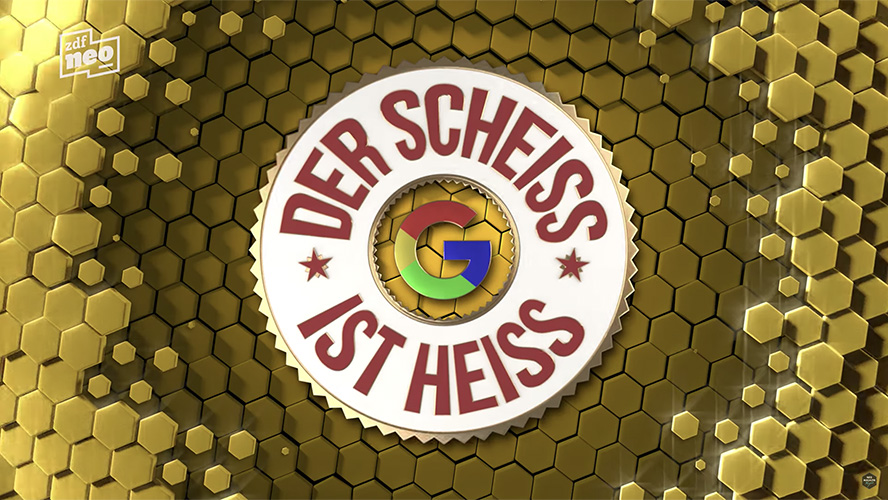

# :fire: The Shit Is Hot

[](https://twitter.com/tobihagemann)


This project is inspired by the segment [Der Scheiß ist heiß](https://www.youtube.com/watch?v=upm6SfYuGX4) on [NEO MAGAZIN ROYALE](https://de.wikipedia.org/wiki/Neo_Magazin_Royale). It's derived from _The Price Is Right_: you're shown five words one at a time and have to place them in the right order, from least to most popular.

You can play _The Shit Is Hot_ at [shitishot.de](https://shitishot.de).

More background information and reactions to the 2018 release can be read in my [blog post](https://tobiha.de/2018/03/26/the-shit-is-hot/). It's in German since this game is inspired by a German late-night talk show.

## How the numbers work

The original game counted search-engine hits. No search API hands out hit counts for free any more, so each word is a Wikipedia article. Its number is that article's pageviews over the last 30 days, rounded to three significant digits.

- New games draw their words from Wikipedia's most-viewed or random articles.
- Custom games resolve each term to an article: the exact title or a redirect, otherwise the top search hit. A term that matches no article can't be played.

Everything runs in the browser: it talks directly to the public Wikimedia APIs and keeps settings, tutorial progress and the current game in localStorage. There is no backend.

## Made With

- [Vue](https://vuejs.org/) and [Vite](https://vite.dev/)
- [Tailwind CSS](https://tailwindcss.com/)
- [vue-i18n](https://vue-i18n.intlify.dev/)
- [Reka UI](https://reka-ui.com/) and [Heroicons](https://heroicons.com/)

## Install

Install [Node.js](https://nodejs.org/) 22 or later and enable [pnpm](https://pnpm.io/) via Corepack (`corepack enable`), then:

```
pnpm install
```

## Start

```
pnpm dev
```

The dev server runs at http://localhost:18489.

## App icon

The icon's source is the Icon Composer document `brand/TheShitIsHot.icon`. It has a sky gradient fill and one glass layer per color: the outer and inner flame of Font Awesome Free's solid `fire` icon, with a ring cut out of the outer flame around the inner one.

Its colors live in `icon.json` as Display P3, converted from Tailwind's oklch tokens: sky-500 to sky-700 for the fill, yellow-400 and orange-500 for the flames.

`pnpm icon` renders the document through the `ictool` inside Xcode's Icon Composer, so it runs only on a Mac with Xcode installed. It writes `apple-touch-icon.png` with its corners filled, because iOS paints a transparent corner black. From the same layers drawn flat in sRGB, it writes `favicon.svg`, `favicon.ico` and the header and social logos in `public/assets`. CI never runs it and the tests only check image sizes, so re-render in the same commit as any edit to the document.

## Deploy

Every push to `main` runs the quality gate in GitHub Actions and, once it passes, deploys the build to GitHub Pages at [shitishot.de](https://shitishot.de). The custom domain lives in the repository's Pages settings.

## License

Distributed under the MIT license. See the LICENSE file for more info.

The app icon and logos are based on the "fire" icon from [Font Awesome Free](https://fontawesome.com), licensed under [CC BY 4.0](https://fontawesome.com/license/free).
